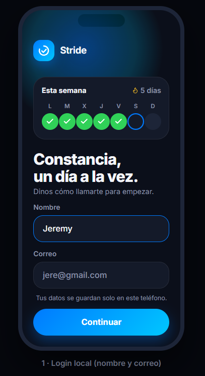
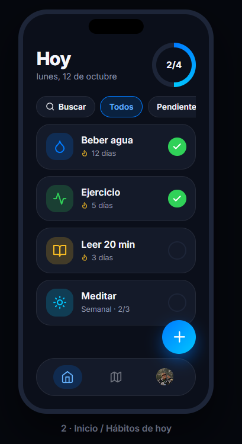
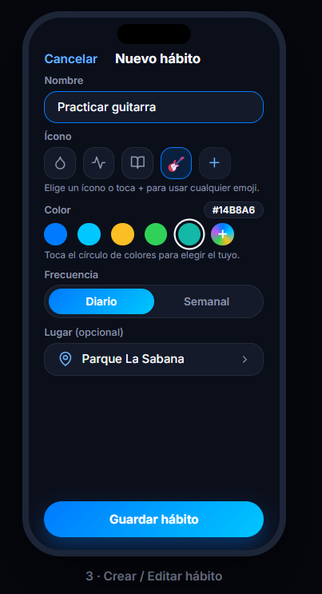
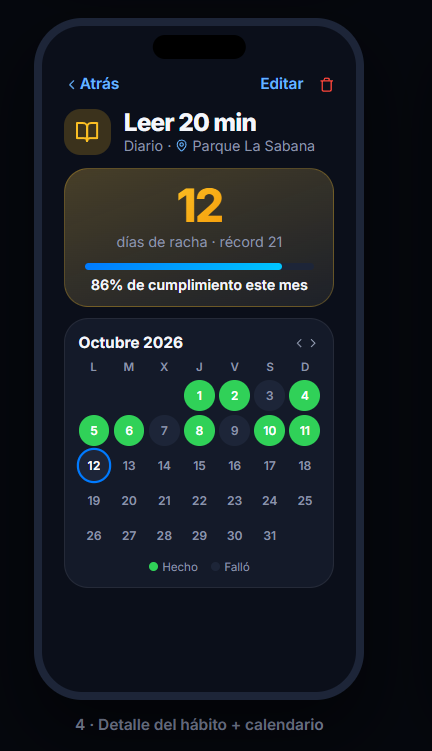
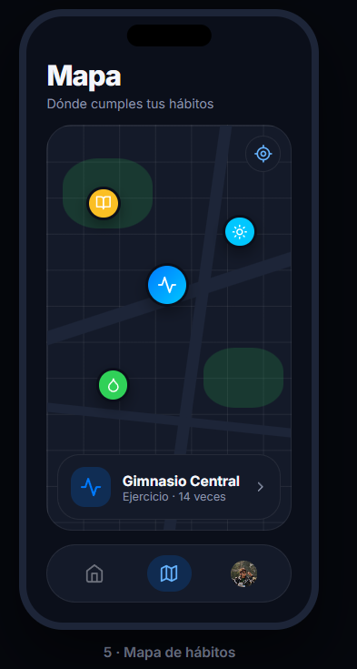
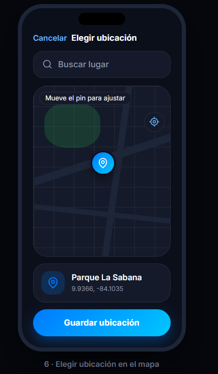
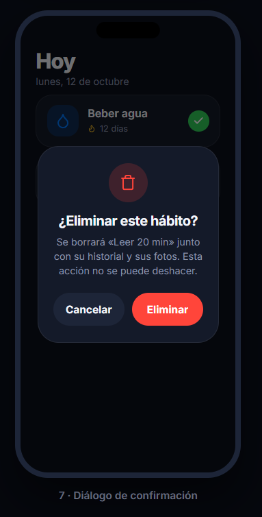
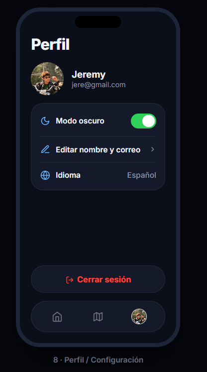
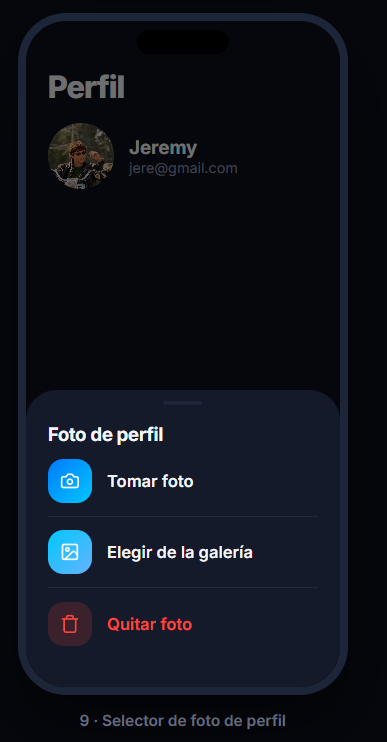

# Stride

> Idea de app móvil para crear, mantener y visualizar hábitos diarios, con rachas, calendario mensual y mapa de lugares.

**Constancia, un día a la vez.**

## Descripción de la idea

Stride ayuda a los usuarios a construir constancia. Permite registrar hábitos personalizados como beber agua, hacer ejercicio, leer, etc., marcarlos como cumplidos cada día y seguir su progreso con la racha y un calendario mensual de cada hábito. Cada hábito puede tener un ícono o usar un emoji y un color a elección del usuario, y puede asociarse a un lugar elegido en el mapa.

El objetivo es ofrecer una herramienta sencilla y fácil de usar que fomente la constancia mediante retroalimentación visual.

## Integrantes

| Nombre | Usuario de GitHub |
|---|---|
| Jeremy Delgado | JeremyDlg |

Proyecto individual.

## Funcionalidades requeridas

| Requisito | Cómo se cumple en Stride |
|---|---|
| CRUD | Crear, ver, editar y eliminar hábitos y sus registros diarios. |
| Lista con filtros personalizados | Lista de hábitos de hoy con filtros: buscar por nombre, todos, pendientes, hechos, diarios y semanales. |
| Acceso a cámara o galería | Foto de perfil tomada con la cámara o elegida desde la galería. |
| Dialog | Confirmación al eliminar un hábito, selector de foto de perfil y selector de color personalizado. |
| Mapa | Elegir la ubicación de un hábito en el mapa y ver todos los lugares con pines en una pantalla de mapa. |

## Mockups ilustrativos

### 1. Login 

Pantalla de bienvenida con el logo, una tarjeta con el progreso de la semana, con campos: nombre y correo. Se usan para personalizar el perfil. El botón Continuar lleva al inicio.

### 2. Inicio / Hábitos de hoy

Muestra la fecha y un anillo con los hábitos completados del día. Una fila de chips permite filtrar la lista. Cada hábito es una tarjeta con ícono, color, racha y un check para marcarlo como cumplido. Al tocar la tarjeta se abre el detalle. El botón + crea un hábito nuevo.

### 3. Crear / Editar hábito

Formulario con nombre, ícono o cualquier emoji, color personalizado, frecuencia sea diaria o semanal y lugar opcional, que abre el mapa para elegir la ubicación.

### 4. Detalle del hábito

Muestra la racha actual, el récord, el porcentaje de cumplimiento del mes y el lugar del hábito. Incluye un calendario, los anillos verde significa completado, gris: no cumplido, anillo azul: hoy. Tiene botones para editar y eliminar.

### 5. Mapa de hábitos

Mapa con un pin por cada lugar donde se cumplen hábitos. Al tocar un pin se muestra una tarjeta con el lugar y las veces que se cumplió el habito en ese lugar.

### 6. Elegir ubicación

Mapa con un pin ajustable y un buscador. Muestra el nombre y las coordenadas del punto elegido.

### 7. Diálogo de confirmación

Diálogo que pregunta ¿Eliminar este hábito? y advierte que se borrará su historial. Ofrece Cancelar o Eliminar.

### 8. Perfil / Configuración

Foto, nombre y correo del usuario. La foto se cambia tocándola, lo que abre el selector de foto. Incluye edición de nombre y correo, modo oscuro, idioma y cierre de sesión.

### 9. Selector de foto de perfil

Panel inferior con las opciones Tomar foto, Elegir de la galería y Quitar foto.